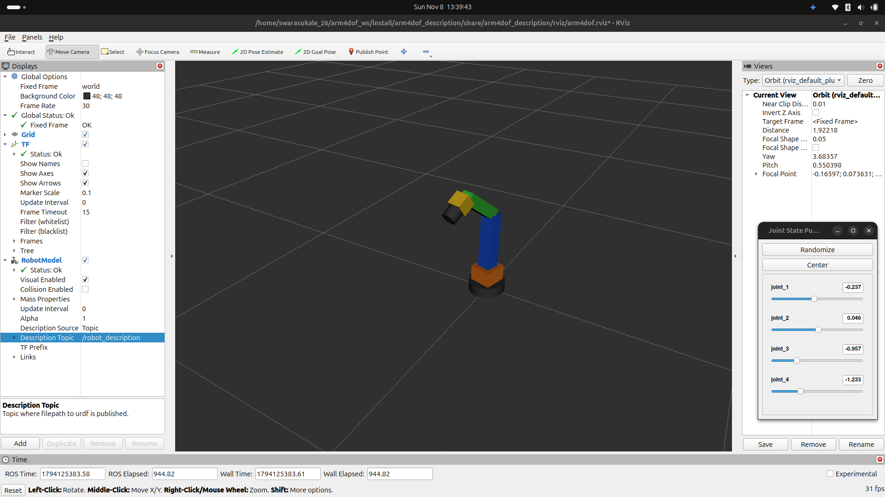
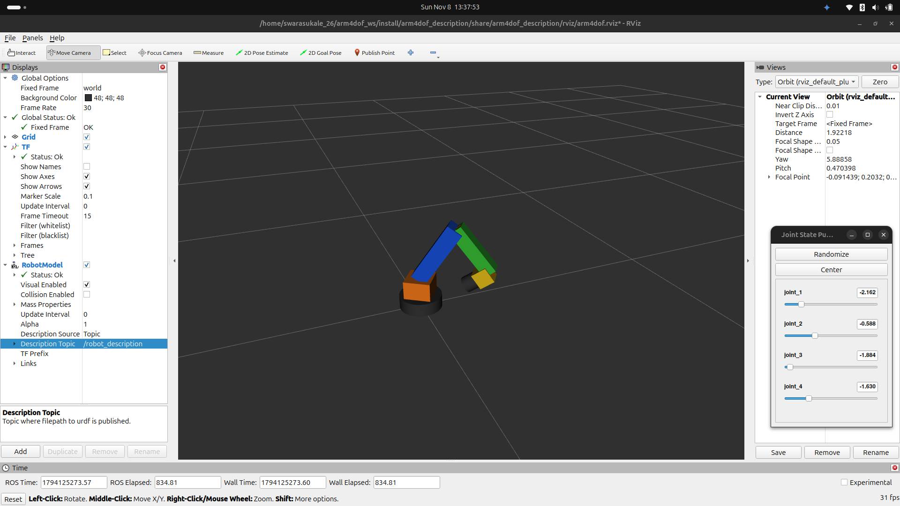

# 4-DOF Robotic Arm

A ROS 2-based 4-Degree-of-Freedom (4-DOF) robotic arm model developed using URDF, Xacro and RViz. This project demonstrates robot modelling, link and joint configuration, and interactive joint visualization.

## Project Overview

This project focuses on designing and visualizing a four-joint robotic arm using ROS 2. The robot is described using a Xacro file, and its structure and movement are visualized in RViz.

The project includes:
- A 4-DOF robotic arm model.
- Four revolute joints and a fixed tool joint.
- Link geometry, visual materials and collision geometry.
- Inertial properties for the robot links.
- Interactive joint control using Joint State Publisher GUI.
- A launch file to start the robot visualization.

## Robot Structure

The robotic arm consists of the following main components:

| Component | Description |
|---|---|
| Base | Fixed cylindrical base |
| Shoulder | First movable section |
| Upper Arm | Main arm link |
| Forearm | Second arm link |
| Wrist | Final movable section |
| Tool | Fixed end-effector representation |

### Degrees of Freedom

| Joint | Motion | Axis |
|---|---|---|
| Joint 1 | Base rotation | Z |
| Joint 2 | Shoulder rotation | Y |
| Joint 3 | Elbow rotation | Y |
| Joint 4 | Wrist rotation | Y |

## Technologies Used

- ROS 2 Jazzy
- Ubuntu 24.04
- URDF
- Xacro
- RViz 2
- Robot State Publisher
- Joint State Publisher GUI
- Python (ROS 2 launch file)

## Project Structure

```text
4dof-robotic-arm/
├── CMakeLists.txt
├── package.xml
├── README.md
├── launch/
│   └── display.launch.py
├── rviz/
│   └── arm4dof.rviz
├── urdf/
│   ├── arm_4dof.urdf.xacro
│   └── graphs/
│       ├── arm4dof.gv
│       ├── arm4dof.pdf
│       └── frames_2026-11-04_15.31.27.pdf
└── screenshots/
    ├── robot_overview.png
    ├── robot_pose_02.png
    └── robot_pose_03.png
```

## Installation and Setup

### Prerequisites

- Ubuntu 24.04
- ROS 2 Jazzy
- Colcon build tools

### 1. Create a ROS 2 workspace

```bash
mkdir -p ~/robot_arm_ws/src
cd ~/robot_arm_ws/src
```

### 2. Clone this repository

```bash
git clone https://github.com/swarasukale26/4dof-robotic-arm.git
```

### 3. Install dependencies

```bash
cd ~/robot_arm_ws
source /opt/ros/jazzy/setup.bash
rosdep install --from-paths src --ignore-src -r -y
```

### 4. Build the package

```bash
colcon build --packages-select arm4dof_description
```

### 5. Source the workspace

```bash
source install/setup.bash
```

### 6. Launch the robotic arm

```bash
ros2 launch arm4dof_description display.launch.py
```

RViz and the Joint State Publisher GUI will open. Use the sliders in the GUI to adjust the four revolute joints and observe the corresponding robot movement in RViz.

## Robot Visualization

### Robot Overview


### Different Joint Configurations





## Learning Outcomes

Through this project, I gained practical experience in:

- Creating robot descriptions using URDF and Xacro.
- Defining links, joints and joint limits.
- Configuring visual, collision and inertial properties.
- Working with ROS 2 packages and launch files.
- Visualizing robot models using RViz.
- Controlling joint positions using Joint State Publisher GUI.

## Author

**Swara Sukale**

B.E. Automation & Robotics Engineering Student

GitHub: [@swarasukale26](https://github.com/swarasukale26)

---

## Copyright & Usage Restrictions

**Copyright © 2026 Swara Sukale. All Rights Reserved.**

This project is publicly available for portfolio viewing, demonstration, and educational showcase purposes.

The original project materials created by the copyright owner, including original designs, documentation, source files, and visual assets, are protected by applicable copyright laws.

No additional permission is granted to reproduce, modify, redistribute, or commercially use these original materials without prior written permission from the copyright owner, except for rights granted under GitHub's Terms of Service and applicable third-party licenses.

Third-party software, libraries, and components remain subject to their respective licenses.

For permission or collaboration inquiries, please contact the copyright owner.
